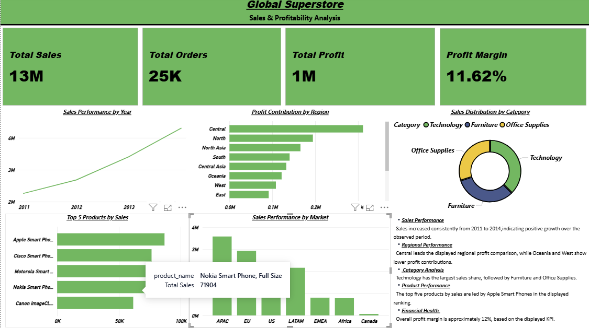

Global Superstore Sales Analytics

Project Overview

An interactive Power BI dashboard designed to analyze global sales performance, profitability, regional contributions, and product trends using business intelligence and data visualization.

Dashboard Preview

Project Objectives
* Analyze overall sales and profit performance.
* Identify top-performing products.
* Compare sales across different markets and regions.
* Understand category-wise sales distribution.
* Track business performance over time.

Tools & Technologies
* Microsoft Power BI
* power Query
* DAX (Data Analysis Expressions)
* Data Visualization
 
Key Performance Indicators
* Total Sales
* Total Orders
* Total Profit
* Profit Margin
 
Key Business Insights
* Sales increased consistently from 2011 to 2014.
* Central leads the displayed regional profit comparison.
* Technology contributes the largest category sales share.
* Apple products lead the displayed top-five product sales ranking.
* Overall profit margin is approximately 12%.
* Project Files

Asif Saleh Naseer Project.pbix – Power BI dashboard.
dashboard.png – Dashboard screenshot
